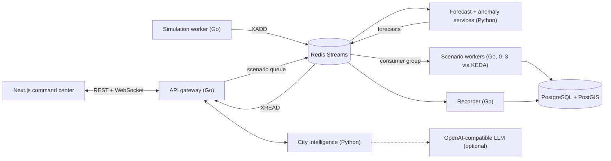

# Nexus City — AI-Powered Smart City Digital Twin

A live digital twin of **Nexus City**, a fictional city of ~360,000 people.

- A deterministic **Go simulation** runs the city's traffic, signals, incidents, weather, air quality,
  electricity demand and emergency calls.
- **XGBoost and Isolation Forest** models, trained on *other* simulated cities, forecast and watch it
  live.
- A **what-if engine** branches the live city to test decisions such as road closures, adaptive
  signals or a heatwave.
- **City Intelligence** answers questions from live data, forecasts and scenario runs, and checks
  every number against its source.
- A **Next.js command center** shows it all in real time.
- The whole system runs on **Kubernetes**: KEDA scales the scenario workers on the queue, and
  Prometheus and Grafana monitor every service.

   

> **Everything here is synthetic.** Every value comes from the simulation, and nothing is a
> measurement of a real city. Model scores show how well a model learned the simulator, not
> real-world forecasting skill.

## Demo Video

A short walkthrough of every feature:
- the live city and the digital twin map;
- AI forecasts and the model benchmarks;
- a what-if road closure;
- City Intelligence;
- Kubernetes autoscaling.

Waiting periods are sped up 8× and labelled on screen.

https://github.com/user-attachments/assets/719984bb-2df3-4fa7-be55-318cd2b36a83

## Features

| Page | What it does |
|---|---|
| **Overview** | City-wide congestion, grid load, PM2.5, live alerts and events |
| **Live Twin** | MapLibre map with moving vehicles, layers, an entity inspector, replay of past hours and a +30 min forecast overlay |
| **AI Predictions** | Roads to watch, the 24 h electricity outlook, air quality in an hour, anomaly flags and live accuracy against baselines |
| **Model Lab** | The benchmark for each served model: test days vs an unseen city, hard cases, feature importance |
| **Scenario Lab** | Close roads, add demand, try adaptive signals, an industrial spike or a heatwave, then compare baseline and scenario side by side |
| **City Intelligence** | A chat assistant with nine data tools, either an OpenAI-compatible LLM or a rule-based mode, plus a grounding check on every number |
| **Infrastructure** | Live pods, workloads and KEDA autoscaling read from the Kubernetes API and Prometheus |

## Architecture



- **One clock, one schema:** the simulation owns the clock, and every message shares one envelope
  (`schema`, `run_id`, `seed`, `tick`, `sim_time`, `payload`).
- **Deterministic branching:** the state after *N* steps depends only on `(seed, N)`. A scenario
  replays the run up to a moment, then clones it into a baseline branch and a scenario branch.
  The same spec always gives the same result hash.
- **Async scenario execution:** the gateway queues an ID and returns at once. Workers in a Redis
  consumer group pick up scenarios, with at-least-once delivery and reclaim of stalled jobs.

The full design, event schemas, database schema and simulation model are in
[docs/architecture.md](docs/architecture.md).

## Tech stack

| Layer | Tools |
|---|---|
| Simulation, gateway, workers | Go 1.26, Redis Streams, WebSockets |
| Machine learning | Python 3.12, XGBoost, scikit-learn, FastAPI, MLflow, uv |
| Assistant | Python, FastAPI, OpenAI SDK (any OpenAI-compatible endpoint; Gemini by default) |
| Storage | PostgreSQL 17 + PostGIS 3.5 |
| Frontend | Next.js 16, Tailwind 4, shadcn/ui, MapLibre GL, Recharts, Motion |
| Platform | Docker, Kubernetes (Kustomize), KEDA, Prometheus, Grafana |

## Quick start

Copy `.env.example` to `.env` and set `POSTGRES_PASSWORD`:

```powershell
Copy-Item .env.example .env
```

Train the models once (about 8 minutes, needs Go and [uv](https://docs.astral.sh/uv/)). Without
them everything else still runs, and the prediction panels say that no model is available.

```powershell
cd ml
uv sync --extra tracking
uv run nexus-ml generate
uv run nexus-ml train all
```

### Option A: Docker Compose

```powershell
docker compose up --build
```

Open <http://localhost:3000>. The gateway is on <http://localhost:8080>. City Intelligence runs in
rule-based mode unless `LLM_API_KEY` (or `GEMINI_API_KEY`) is set. To add scenario workers:
`docker compose up -d --scale scenario-worker=3`.

### Option B: Kubernetes (Docker Desktop)

Create a cluster on Docker Desktop's Kubernetes page (kubeadm, 1 node), then:

```powershell
powershell -File deploy\k8s\build-images.ps1
powershell -File deploy\k8s\deploy.ps1
```

| Service | URL |
|---|---|
| Command center | <http://localhost:3000> |
| Gateway | <http://localhost:8080> |
| Grafana | <http://localhost:3001> |

Details are in [deploy/k8s/README.md](deploy/k8s/README.md).

### Option C: Local development

You need Go 1.26+, Node 24+, a Redis 7 compatible server on `localhost:6379`, and, for scenarios,
a PostGIS database. Run each service in its own terminal:

```powershell
cd core; go run ./cmd/sim          # simulation worker
cd core; go run ./cmd/gateway      # REST + WebSocket API
cd core; go run ./cmd/scenario     # scenario worker
cd core; go run ./cmd/recorder     # stream → database writer
cd ml; uv run nexus-ml serve --models traffic,energy,pm25,anomaly
cd assistant; uv run nexus-assistant serve
cd web; npm install; npm run dev
```

Set `REDIS_URL`, `DATABASE_URL` and the other variables from [`.env.example`](.env.example). The
simulation starts at **Mon 1 June 2026, 05:30**. Switch to **60×** in the top bar to watch the
morning rush build.

A 15-minute guided tour is in [docs/demo.md](docs/demo.md).

## Project structure

```
core/        Go module: simulation engine, city generator, gateway, scenario worker, recorder
  cmd/       sim · gateway · scenario · recorder · headless (offline batch runner)
  internal/  sim, city, scenario, gateway, bus, events, store (PostGIS + migrations), ...
ml/          Python package nexus_ml: datasets, features, forecasting, anomaly detection, FastAPI
assistant/   Python package nexus_assistant: tools, LLM loop, rule-based mode, grounding check
web/         Next.js command center
deploy/k8s/  Kustomize manifests, KEDA ScaledObject, Prometheus + Grafana, build/deploy scripts
docs/        Architecture and demo script
```

## Machine learning

Models train only on cities other than the live one, use embargoed chronological splits and are
also tested on a held-out city. Tests guard against look-ahead leakage and train/serve skew.

## Benchmarks

Measured on a laptop (Ryzen 7 7445HS, 15 GB RAM). Full tables, dates and conditions are in
[docs/benchmarks.md](docs/benchmarks.md).

| What | Result | The honest part |
|---|---|---|
| Traffic forecast (XGBoost) | MAE 0.043–0.046 at +15/30/60 min | Only **10–16%** better than a plain ridge regression; rush-hour error is ~3× higher |
| Energy forecast (XGBoost) | 38–53% lower MAE than a 7-day seasonal baseline | The simulator's demand curve is smoother than a real grid's |
| PM2.5 forecast (XGBoost) | 35–49% lower MAE than persistence | Persistence is a weak baseline; error rises 30–42% on an unseen city |
| Anomaly detection (Isolation Forest) | F1 0.12–0.48 | **Loses to simple rules** or ties in every domain, so rules stay primary |
| Simulation speed | ~25,000–29,000 simulated seconds per second | Same final state hash on every repeat run |
| What-if scenario (2 h) | 1.5–3 s | When branching early in a run; each simulated day of replay adds ~3 s |
| Autoscaling (12-scenario burst) | 0 → 3 workers in 34 s, back to 0 in ~2 min | Single-node Docker Desktop cluster |
| Tests | Go 50 passed (5 skipped), ML 21 passed, assistant 25 passed | Skipped tests need PostGIS; no CI; no web tests |

All model scores come from the project's own simulator, so they show how well the models learned
the simulator, not real-world skill. More in [ml/README.md](ml/README.md) and `ml/reports/`.

## Tests

```powershell
cd core; go test ./...
cd ml; uv run pytest
cd assistant; uv run pytest
cd web; npm run lint; npm run typecheck; npm run build
```

The tests cover:

- simulation determinism, and that clock speed never changes results;
- road-graph connectivity and schema compatibility between Go, Python and TypeScript;
- WebSocket delivery and an end-to-end flow from the worker through Redis and the gateway to REST;
- data leakage and train/serve parity for the models;
- scenario reproducibility, plus a complete scenario run through queue → worker → PostGIS → model
  service.

Go tests use an in-memory Redis (miniredis). The database tests run when `NEXUS_TEST_DATABASE_URL`
points at a scratch PostGIS database, and are skipped otherwise.

## API

The gateway (port 8080) serves the whole system:

- **City and clock:** `/api/city`, `/api/clock`
- **Telemetry:** `/api/telemetry/*`, `/api/history/{kind}/{id}`, `/api/events`
- **Models:** `/api/models`, `/api/forecasts/*`, `/api/anomalies/latest`
- **Scenarios:** `/api/scenarios`
- **Assistant:** `/api/assistant/chat`
- **Infrastructure:** `/api/infra`
- **Live stream:** `/ws`
- **Metrics:** `/metrics` (every service has one)

The route table is in [core/internal/gateway/server.go](core/internal/gateway/server.go).

## Configuration

See [`.env.example`](.env.example). The only secrets are `POSTGRES_PASSWORD` and the optional
`LLM_API_KEY` (or `GEMINI_API_KEY`). They live in `.env`, which git ignores, and are never
written into the code or manifests.

## Limitations

This is a portfolio project, not a production system. What it does **not** do:

**Data and models**
- **All data is synthetic.** No real city, sensor or grid data is used, and nothing was validated
  against reality.
- **Circular evaluation.** The models are trained and tested on the same simulator, so good scores
  partly reflect how simple the simulator is.
- **Weak spots:**
  - the anomaly detector does not beat simple rules;
  - the traffic model is only modestly better than linear regression;
  - the energy model has no weather forecast input.
- **Simple physics.** The PM2.5 model is a toy dispersion model, not an air-quality model.
- **Simple traffic.** Each vehicle agent stands for 8 cars. Roads are straight segments with no
  turn lanes. Drivers reroute only around closed roads, not around jams.

**Scenarios and assistant**
- **Model responses, not evidence.** Scenario results show how the simulator reacts to a change.
  The forecasts inside them come from models that never saw a closed road or adaptive signals.
- **7-day cap.** Scenarios can only branch within the first 7 simulated days of a run, because they
  replay from the seed and there are no checkpoints.
- **Assistant answers are slow and limited.** City Intelligence takes 10–30 s per answer and reports
  what the data shows, not causes. Its grounding check catches invented numbers, but not wrong
  reasoning.

**Engineering**
- **No authentication or rate limiting.** Anyone who can reach the gateway can pause or reset the
  city, queue scenarios and use the assistant. It is not safe to expose to the internet as it is.
- **No high availability.**
  - The simulation and gateway run as single instances, and the gateway keeps its history in
    memory.
  - Redis and Prometheus don't persist data.
  - The Kubernetes setup is one local node.
- **Not deployed publicly.** It runs on Docker Compose or local Docker Desktop Kubernetes, and the
  deploy scripts are PowerShell, tested only on Windows.
- **Testing gaps.**
  - There is no CI.
  - The database tests need a PostGIS instance and are skipped by default.
  - The web app has no automated tests.
  - There has been no load test with many users.
- **Accessibility.** Checked with scripts and by hand, not with screen-reader users. The map itself
  has no text equivalent beyond the inspector and the lists.

More detail is in
[docs/architecture.md § 12](docs/architecture.md#12-assumptions-and-limitations).
