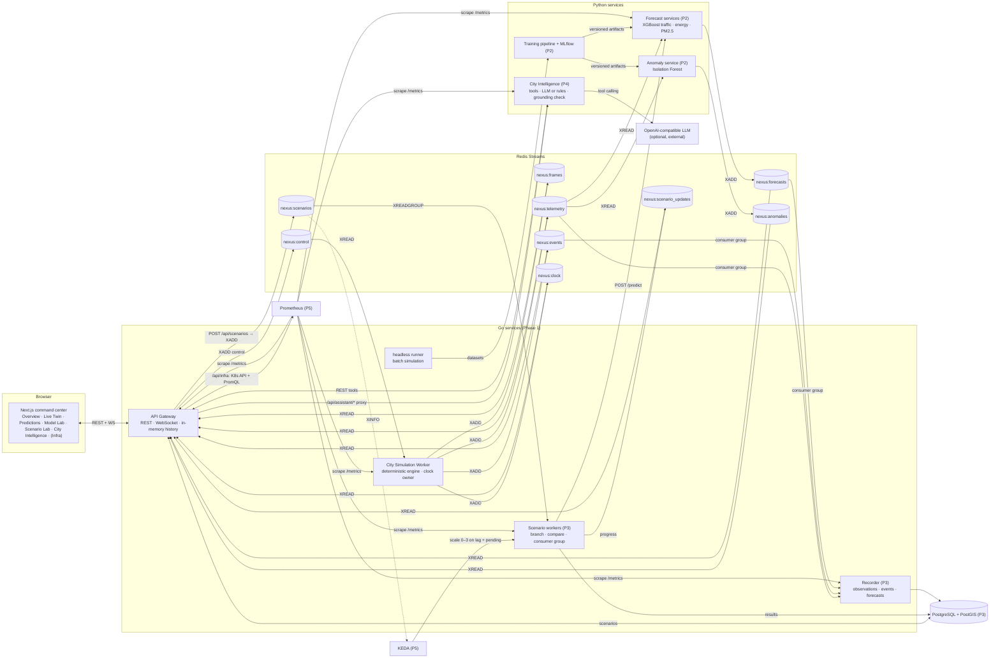

# Nexus City — Architecture

Nexus City is a digital twin of a **fictional** city. A deterministic Go simulation produces
everything the system shows; Python ML services learn from that simulation (on cities other
than the live one) and predict it; a Go gateway serves it all to a Next.js command center. Every number on screen
traces back to a simulation step. Nothing is generated in the UI, and nothing is real-world data.

## 1. Overview

| Concern | Choice | Why |
|---|---|---|
| Simulation | **Go** (`core/internal/sim`) | Tight tick loop over ~1–2k vehicle agents plus a 972-cell pollution field; ~26–29k simulated seconds per wall second on a laptop CPU ([benchmarks](benchmarks.md)). Deterministic by construction. |
| Realtime edge | **Go** gateway (`core/internal/gateway`) | WebSocket fan-out and Redis Streams consumption in one small binary. |
| ML | **Python** (`ml/`, Phase 2) | XGBoost, scikit-learn, FastAPI, MLflow. |
| Assistant | **Python** (`assistant/`, Phase 4) | FastAPI, the OpenAI SDK against any OpenAI-compatible endpoint (Gemini by default), and a deterministic rule-based mode. A pure client of the gateway's REST API. |
| Event bus | **Redis Streams** | Ordered, capped, replayable. Consumer groups share the scenario queue across workers (KEDA scales the workers on its lag and pending count) and let the recorder catch up after downtime. |
| Storage | **PostgreSQL 17 + PostGIS 3.5** (Phase 3) | Scenario configs and results, city geometry for spatial queries, and the recorder's 5-minute observations, events and forecasts with retention. Live history also stays in Redis and gateway memory; datasets are CSV; models are versioned files. |
| Frontend | **Next.js 16**, Tailwind 4, shadcn/ui (Base UI), MapLibre GL 6, Recharts 3, Motion | — |
| Platform | **Kubernetes** (Docker Desktop), Kustomize, **KEDA**, **Prometheus**, **Grafana** (Phase 5) | Plain manifests that `kubectl` applies without extra tools; KEDA scales scenario workers 0–3 on the Redis queue; every service exposes `/metrics`. |

**One clock, one schema.** The simulation worker owns the clock. Every message carries the
same envelope (`schema`, `run_id`, `seed`, `tick`, `sim_time`, `emitted_at`, `payload`), so any
service can line up data from different streams by `(run_id, tick)`.

**Branching.** A what-if scenario rebuilds the city at any moment of a run by re-simulating
from the seed, which takes about 3 seconds per simulated day on a laptop CPU. It then clones the engine into a
baseline branch and a scenario branch, so both start from the identical state. The same property lets a
restarted simulation worker resume its run instead of starting over.

**Determinism.** The engine advances in fixed one-second steps. Its state after *N* steps is a
pure function of `(seed, N)`. Changing speed, pausing or reading output only changes how often
steps run, never what they do (`TestSpeedChangesDoNotAffectResults`). Each subsystem
(traffic, incidents, environment, energy, sensor faults, emergencies, injected anomalies) draws from its own PCG
stream, so adding randomness in one never shifts another.

## 2. Repository structure

```
.
├── core/                       Go module "nexuscity" — simulation + gateway        [Phase 1 ✓]
│   ├── cmd/
│   │   ├── sim/                City Simulation Worker (Redis publisher, run resume, /healthz)
│   │   ├── gateway/            API Gateway (REST + WebSocket)
│   │   ├── scenario/           Scenario Execution Worker (queue consumer group)       [Phase 3 ✓]
│   │   ├── recorder/           Data Storage Layer writer + retention                  [Phase 3 ✓]
│   │   └── headless/           Offline runner: datasets, telemetry, `-scenario` (Job entry point)
│   ├── internal/
│   │   ├── city/               Seeded city generator, road graph, Dijkstra
│   │   ├── sim/                Engine: traffic, signals, incidents, weather, PM2.5, energy, EMS, alerts,
│   │   │                       interventions, en-route rerouting, adaptive signals, Clone()
│   │   ├── scenario/           Spec validation, baseline/scenario branching, comparison, result hash
│   │   ├── scenarioworker/     Queue consumption, PostGIS context, model forecasts per branch
│   │   ├── store/              PostgreSQL + PostGIS: embedded migrations, scenarios, recorder tables
│   │   │   └── migrations/     001_init.sql
│   │   ├── recorder/           Stream → database persistence
│   │   ├── events/             Wire contract (envelope, telemetry, frames, events, control)
│   │   ├── bus/                Redis Streams helpers and retention caps
│   │   ├── simworker/          Wall-clock driver, control queue, heartbeat
│   │   ├── gateway/            Stream consumer, history, REST, WebSocket hub, live forecast scoring
│   │   └── health/             `healthcheck` subcommand for distroless images
│   └── Dockerfile              One image per binary via --build-arg SERVICE
├── web/                        Next.js command center                              [Phase 1–4 ✓]
│   ├── src/app/                / (Overview), /twin, /predictions, /models, /scenarios, /intelligence
│   ├── src/components/         shell, map, twin, overview, predictions, models, scenarios (lab, diff map),
│   │                           intelligence (chat), charts, ui
│   └── src/lib/                types (mirror of the Go contract), api, store, history hook, formatting
├── docs/architecture.md        This document
├── ml/                         Python package nexus_ml                             [Phase 2 ✓]
│   ├── src/nexus_ml/           grid, features, forecast, anomaly, registry, service (FastAPI), cli
│   ├── tests/                  no-look-ahead, train/serve parity, inference, HTTP interface
│   ├── reports/                Markdown benchmark of the current model versions
│   ├── data/ models/ mlruns/   generated datasets, versioned artifacts, MLflow (git-ignored)
│   └── Dockerfile              one image; Compose runs one model per container
├── assistant/                  Python package nexus_assistant                      [Phase 4 ✓]
│   ├── src/nexus_assistant/    gateway client, entity resolution, tools, rules mode, LLM loop,
│   │                           number grounding, FastAPI service, cli
│   ├── tests/                  against captured real gateway responses (tests/fixtures)
│   └── Dockerfile
├── docker-compose.yml          Compose mode: redis, postgis, sim, gateway, scenario-worker, recorder,
│                               assistant, web, 4 model services                      [Phase 4 ✓]
├── .env.example
│
└── deploy/k8s/                 Kubernetes (Kustomize)                               [Phase 5 ✓]
    ├── base/                   app manifests, probes, limits, RBAC, KEDA ScaledObject
    ├── monitoring/             Prometheus (pod discovery) + Grafana (provisioned dashboard)
    ├── overlays/docker-desktop/ local images, LoadBalancer services on localhost
    └── build-images.ps1, deploy.ps1
```

Only the parts marked ✓ exist today. The rest is the plan, kept here so each phase lands in a known place.

## 3. Architecture diagram



Solid lines run today. Dashed lines are later phases. The gateway scores each forecast when its target time arrives (live accuracy).

## 4. Event schemas

Every Redis stream entry has one field, `data`, holding an envelope:

```json
{
  "schema": "nexus.telemetry/v1",
  "run_id": "42-20261119T070328.626",
  "seed": 42,
  "tick": 3600,
  "sim_time": "2026-06-01T06:30:00Z",
  "emitted_at": "2026-11-19T07:04:28.112Z",
  "payload": { }
}
```

`tick` is the number of simulated seconds since the run's epoch (Mon 1 June 2026 05:30, city time,
carried as UTC). `emitted_at` is wall time and is excluded from determinism checks.

| Stream | Schema | Cadence | Retention (approx. MAXLEN) | Payload |
|---|---|---|---|---|
| `nexus:frames` | `nexus.frame/v1` | ≤ 5 Hz wall | 50 | `vehicles: [[id, lon, lat, heading_deg, speed_kmh]…]`, `scale` (real vehicles per agent) |
| `nexus:telemetry` | `nexus.telemetry/v1` | 1 per simulated minute | 1 440 (1 sim day, ~32 KB each) | `weather`, `summary`, `roads[]`, `nodes[]`, `districts[]`, `stations[]`, `hospitals[]`, `incidents[]`, `alerts[]`, `pm_grid[]` |
| `nexus:events` | `nexus.event/v1` | as they happen | 5 000 | `kind`, `severity`, `entity_type`, `entity_id`, `message`, `data` |
| `nexus:clock` | `nexus.clock/v1` | on change + every 2 s | 200 | `speed`, `paused`, `tick`, `sim_time`, `epoch`, `seed`, `run_id` |
| `nexus:control` | raw `Control` | on request | 200 | `{"action": "pause"\|"resume"\|"speed"\|"reset", "speed"?, "seed"?}` |
| `nexus:forecasts` | `nexus.forecast/v1` | every 5 sim-min (energy hourly) | 3 000 | `model`, `version`, `entity_type`, `horizons`, `target_ticks`, `issued_tick`, `entities[]`, `values{horizon: [...]}`, `latency_ms` |
| `nexus:anomalies` | `nexus.anomaly/v1` | every 5 sim-min | 1 000 | `version`, `issued_tick`, `flagged[]` (entity, score, reason), `top{traffic,energy,air}` |
| `nexus:scenarios` | `{id}` (queue entry) | per request | 5 000 | Consumer group `scenario-workers`; unacknowledged entries are reclaimed after 10 min |
| `nexus:scenario_updates` | `nexus.scenario/v1` | on status/progress change | default | `id`, `status`, `phase`, `progress`, `error?`, `result_hash?`, `worker` |

Telemetry arrays are ordered exactly like the city's `roads`, `districts`, signalised `nodes`,
AQ `stations` and `hospitals`, and each element also carries its `id`. Key per-entity fields:

- **RoadObs**: `flow_vph`, `speed_kmh`, `congestion` (0 free-flow … 1 jammed), `vehicles`, `incident?`
- **DistrictObs**: `demand_mw`, `capacity_mw`, `utilization`, `pm25` (field mean), `vehicles`, `calls_1h`, `avg_eta_min`
- **StationObs**: `pm25` (`null` when offline), `status` (`ok` \| `stuck` \| `offline`)
- **Alert**: `kind`, `severity`, `entity_type`, `entity_id`, `title`, `detail`, `value`, `source` (`rule`), `opened_at`. Model anomalies travel separately on `nexus:anomalies`.

Event kinds: `incident.started`, `incident.cleared`, `emergency.call`, `sensor.fault`,
`sensor.recovered`, `alert.opened`, `alert.resolved`, and the injected ground-truth anomalies
`anomaly.energy_surge.started/ended` and `anomaly.emission_release.started/ended`.

Redis keys: `nexus:city` (city JSON), `nexus:clock:latest`, `nexus:sim:heartbeat` (hash, 10 s TTL),
`nexus:models` (hash: per-model service status, 60 s TTL) and `nexus:model_meta:<kind>` (training
metadata of the served version, 120 s TTL).

The Go types in `core/internal/events/events.go` are the source of truth;
`web/src/lib/types.ts` mirrors them, and `TestTelemetryFieldNames` guards the JSON names.

## 5. Database schema (implemented in Phase 3)

The schema lives in `core/internal/store/migrations/` and is applied automatically (versioned,
under an advisory lock) by whichever service starts first. It was planned for Phase 2 and moved to
Phase 3, where scenario configs and results were the first data that had to outlive a run. The design
separates **observations** (what the simulation produced), **forecasts** (what a model
predicted) and **scenario projections** (what a what-if run produced):

```sql
-- Static city, versioned by seed + generator version
cities(id, seed, generator_version, created_at, UNIQUE(seed, generator_version))
districts(city_id, id, name, type, population, jobs, floor_area_m2, base_load_mw, substation_mw, geom geometry(Polygon, 4326))
intersections(city_id, id, name, signalized, cycle_s, green_ns_s, offset_s, geom geometry(Point, 4326))
road_segments(city_id, id, name, class, a_node, b_node, length_m, lanes, speed_kmh, district_id, geom geometry(LineString, 4326))
facilities(city_id, id, kind, name, district_id, node_id, capacity, geom geometry(Point, 4326))

-- One row per simulation run (live or headless); seed + params make it reproducible
simulation_runs(id, city_id, seed, kind /*live|training|scenario*/, params jsonb, started_at, ended_at)

-- Observations: one row per entity per simulated minute (partitioned by run, retention-pruned)
traffic_observations(run_id, tick, sim_time, road_id, flow_vph, speed_kmh, congestion, vehicles, incident_id)
pollution_observations(run_id, tick, sim_time, station_id, pm25 /*NULL = missing*/, status)
electricity_observations(run_id, tick, sim_time, district_id, demand_mw, utilization, temp_c)
simulation_events(run_id, tick, sim_time, kind, severity, entity_type, entity_id, message, data jsonb)

-- Model outputs, never mixed with observations
model_versions(id, model /*traffic|energy|pm25|anomaly*/, version, trained_on_run_ids, metrics jsonb, artifact_uri, mlflow_run_id, created_at)
forecasts(id, model_version_id, run_id, issued_tick, target_tick, entity_type, entity_id, horizon_min, value, lower, upper)

-- What-if engine
scenario_configs(id, name, kind, params jsonb, base_run_id, base_tick, seed, created_at)
scenario_results(id, scenario_id, status, sim_run_id, baseline_run_id, metrics jsonb, diffs jsonb, started_at, finished_at)
```

As built, `simulation_runs` also tracks each run's `last_tick`. `scenario_configs` carries status,
progress, phase, error and worker, and `scenario_results.result` holds the full comparison as JSONB
(summaries, 5-minute series, per-road and per-district deltas, PM2.5 grid delta, model forecasts
and spatial context).

**PostGIS in use:** the worker finds roads within 1.5 km of a closure (`ST_DWithin` on geography)
to report the nearby impact, and air stations within 3 km of an industrial district.

**Retention** (recorder, every 10 min): observations, events and forecasts older than
`RETENTION_SIM_DAYS` simulated days of their run are deleted. Only the newest `RETENTION_RUNS` live
runs and `RETENTION_SCENARIOS` finished scenarios are kept.

## 6. Simulation model (Phase 1)

| Subsystem | Model | Notes |
|---|---|---|
| Layout | 13×10 intersection grid, 750 m blocks, 12 districts of 3×3 blocks; 14% of local streets removed (never disconnecting) | Highway A (E–W) and B (N–S) are grade-separated from local streets; signals only where they meet arterials or each other |
| Demand | Poisson trip generation; weekday double commuter peak, weekend midday hump | Morning trips are 70% home→job, weighted by population and jobs; reversed in the evening |
| Routing | Dijkstra on minute-averaged travel times plus expected signal delay | Chosen at departure; no en-route rerouting yet |
| Traffic flow | Agent-based; each agent = 8 vehicles; Greenshields speed–density per road direction | Congestion index = 1 − v/v_free = density / jam density |
| Signals | Fixed-time two-phase plans (90 s, or 120 s at highway junctions), with offsets | Vehicles queue at red lights; the queue counts toward road density |
| Incidents | Poisson, rate rises with traffic; minor or major lane loss for 20–80 min | Major-road segments only |
| Weather | Smooth deterministic diurnal and multi-day cycles | Temperature, humidity, wind speed and direction |
| PM2.5 | Gaussian-kernel dispersion of road and industrial-stack emissions, shifted downwind, diluted by wind, relaxing with τ = 25 min | Demonstration only, **not** an air-quality model |
| Sensors | 12 AQ stations; random stuck or offline faults for 20–90 min | Offline readings are `null`; stuck sensors repeat their last value |
| Energy | District base load × hourly profile by land use × temperature factor × AR(1) noise | Substations are sized at 1.8–2.0× base load |
| Emergency | Poisson calls ∝ population + local incidents; nearest hospital by live travel time | Exposes a coverage gap in the south-east |
| Alerts | Rules with hysteresis: congestion, incidents, PM2.5, grid load, sensor faults, EMS response | `source: "rule"` |
| Injected anomalies | Energy surges (+20–40%, 30–120 min) and industrial emission releases (×3–6, 20–90 min), each announced as an event | Ground truth for scoring the anomaly detector |

Calibration (seed 42, weekday): network congestion index peaks around 0.29 at ~15 km/h in the
rushes and falls to ~0.05 at midday. Grid demand runs 260–640 MW against 860 MW capacity, and the business-district substations only pass 100% on the hottest afternoon.
Station PM2.5 averages ~12 µg/m³ at night and ~40 µg/m³ in the morning peak.

## 7. Phase plan

| Phase | Deliverable | Status |
|---|---|---|
| 1 — Working digital twin | Synthetic city, road graph, deterministic simulation, shared clock, Redis Streams, Go gateway, Overview + Live Twin, replay, Compose | **Done** |
| 2 — Real ML | Headless dataset generation, chronological splits plus a held-out city, persistence / seasonal-naive / ridge baselines vs XGBoost (traffic 15/30/60 min, district energy 1–24 h, PM2.5 30/60 min), Isolation Forest vs rule baselines, MLflow, FastAPI inference services, live forecast scoring, AI Predictions + Model Lab pages | **Done** |
| 3 — What-if engine | Interventions with en-route rerouting and adaptive signals, deterministic branching from any moment of a run, scenario API + queue + horizontally scalable workers, PostgreSQL/PostGIS with migrations, recorder with retention, run resume, model forecasts per branch, Scenario Lab | **Done** |
| 4 — AI intelligence | City Intelligence: nine tools over live metrics, forecasts, alerts, model quality and the scenario engine; any OpenAI-compatible LLM with a fallback model; deterministic rule-based mode; every number checked against tool data; gateway proxy; chat page | **Done** |
| 5 — Kubernetes + monitoring | Kustomize manifests for Docker Desktop's Kubernetes (probes, requests/limits, non-root, read-only filesystems, namespace RBAC), KEDA scaling of scenario workers 0–3 on queue lag and in-flight count with graceful worker shutdown, Prometheus metrics in every service, Prometheus + provisioned Grafana dashboard, gateway `/api/infra` from the Kubernetes API, Infrastructure page | **Done** |
| 6 — Polish | Accessibility (names, labels, contrast, landmarks, skip link, reduced motion, small-screen navigation), rendering performance (memoised charts; Overview long tasks 20% → 3.5%), 623 MB ML image (CPU-only xgboost), demo script | **Done** |

## 8. Machine learning (Phase 2)

Full details and the honesty rules (no live-city training, embargoed chronological splits,
held-out city, no-look-ahead and train/serve parity tests) are in [ml/README.md](../ml/README.md).
Current results are in `ml/reports/` and the Model Lab page.

| Model | Inputs | Target | Test MAE vs best baseline |
|---|---|---|---|
| Traffic (XGBoost, one per horizon) | 33 features: congestion lags, yesterday at the target time, neighbour and district congestion, incidents, road attributes, time | Congestion index at +15/30/60 min | −11 / −12 / −16% vs ridge |
| Energy (XGBoost, horizon as a feature) | Demand lags, seasonal-naive at the target time, current temperature, district attributes, target time | District demand at +1…24 h | −53% (1 h) … −38% (24 h) vs 7-day seasonal naive |
| PM2.5 (XGBoost, one per horizon) | Last valid reading, lags, other stations, district traffic, wind and downwind-of-industry, time | Station PM2.5 at +30/60 min | −35 / −49% vs persistence |
| Anomaly (Isolation Forest × 3) | Deviations vs yesterday, neighbours and recent change, plus selected levels | Incidents, surges, faulty sensors, emission releases | Below rule baselines on F1 for air and energy; shown as a second opinion |

## 9. What-if engine (Phase 3)

| Scenario | Change applied to the scenario branch | Validation |
|---|---|---|
| Road closure | Roads get infinite routing cost. Vehicles already driving re-plan at their next intersection; those with no route left are counted as stranded | 1–24 existing roads (a whole highway) |
| Rush-hour surge | Trip generation × (1 + pct/100) | 0 < pct ≤ 200 |
| Signal timing | Every signal re-splits its cycle each minute in proportion to the queue on each axis, kept within 25–75% and smoothed | policy `adaptive` |
| Industrial spike | One industrial district's stack emissions × factor | industrial district, 1 < factor ≤ 10 |
| Heatwave | Temperature + Δ °C, which raises cooling load through the demand model | 0 < Δ ≤ 15 |

Durations run from 30 minutes to 6 hours, branching from any tick up to 7 days into a run. Each
spec has a hash, and each outcome has a result hash: the same spec always gives the same result
hash (`TestSameSpecSameResult`, plus an end-to-end rerun in `TestCompleteScenarioExecution`). A
two-hour scenario takes about 1.5–3 s, including the forecasts.

Example outcomes, all branching from the live seed at 08:00 for 2 h:

- Closing one Highway A segment lengthens trips by 1.4 min.
- Adaptive signals shorten them by 1.0 min (−4%).
- +30% demand adds 2.4 min.
- A +6 °C heatwave adds 14% electricity use.

## 10. City Intelligence (Phase 4)

The assistant answers questions about the city only from tool results. It is a separate service
(`assistant/`) and reaches the system through the gateway's public REST API, as the browser does.
The gateway proxies `GET /api/assistant/status` and `POST /api/assistant/chat` to it, so the
browser keeps a single origin.

| Tool | Reads | Returns |
|---|---|---|
| `city_overview` | telemetry, alerts, forecasts | phase of day, weather, congestion, grid, PM2.5, worst districts and roads, traffic forecast |
| `district_report` | telemetry now and an hour ago, forecasts | congestion and its change, worst roads with speeds, incidents, energy, air, EMS |
| `road_report` | telemetry, forecasts | every segment of a named road, with forecasts |
| `traffic_outlook` | traffic forecasts | roads with the highest forecast congestion at +15/30/60 min, and the model's error |
| `energy_outlook` | energy forecasts | each district's forecast peak tonight or over 24 h |
| `air_quality_outlook` | PM2.5 forecasts, telemetry | stations now and in an hour, faulty sensors |
| `active_alerts` | events, anomalies | open alerts and anomaly flags |
| `run_scenario` | `POST /api/scenarios` | runs a real what-if: the comparison, PostGIS context and branch forecasts |
| `model_quality` | model metadata, live accuracy | test error vs baselines, and live scores |

Each tool returns compact JSON with the simulated time and its source (`simulation`,
`forecast:<model version>`, `scenario:<id>`). The tools resolve names to IDs: `District 4`,
`Southgate` and `D4` are the same district, and `Highway A` means its 12 segments.

**Two modes.**
- **LLM mode** (with `LLM_API_KEY`) works with any OpenAI-compatible Chat Completions endpoint
  that supports function tools.
  - **Models:** the default endpoint is Google's Gemini, with `gemini-flash-lite-latest` as the
    model and `gemini-3.5-flash` as the fallback.
  - **Tool loop:** up to six rounds of tool calls. Provider extras on tool calls, such as
    Gemini's thought signatures, are sent back unchanged.
  - **Fallback:** when the first model fails, the fallback model reuses the tool results already
    fetched, so a scenario never runs twice. If every model fails, rules mode answers, with a
    note.
- **Rule-based mode** (no key, or `ASSISTANT_MODE=rules`): intent matching picks the tools and
  templates write the answer. It covers the five brief questions and every scenario kind.

**Grounding check.** Every number in an answer is compared against the numbers in the tool
results, the tool arguments and the question.
- **Allowed:** rounding, percentages (0.26 → 26%) and absolute changes.
- **Ignored:** times, dates, IDs and model versions.
- **Flagged:** numbers with no source go into `grounding.ungrounded` and appear as a warning under
  the answer.

Tests assert that rule-based answers to the five brief questions are fully grounded.

**Honesty rules in the prompt:**
- Use only numbers from the tools.
- Say what is simulated, forecast or a scenario result.
- State the simulated time.
- Explain causes only as far as the data goes. The simulation does not record why a road is
  congested.

## 11. Kubernetes and monitoring (Phase 5)

Details are in [deploy/k8s/README.md](../deploy/k8s/README.md).

- **Manifests:** plain manifests composed with Kustomize (`kubectl apply -k`), with no Helm. One
  overlay targets Docker Desktop's single-node cluster: it uses local images, and publishes the
  web app, gateway and Grafana through LoadBalancer services on localhost.
- **Secrets:** none appear in the manifests. `deploy.ps1` builds the `nexus-secrets` Secret from
  `.env` or the environment.
- **Probes:**
  - Liveness checks real failure: the simulation's `/healthz` fails when its loop stalls.
  - Readiness checks dependencies: the gateway is ready once it consumes the streams, and the ML
    service once its models are loaded and it follows telemetry.
  - A startup probe gives the ML service time to load its models.
- **Autoscaling:** KEDA's `redis-streams` scaler reads the consumer group behind
  `nexus:scenarios`. Lag (waiting) asks for one worker each, and the pending count (in flight)
  keeps busy workers alive. Replicas range from 0 to 3.
- **Worker shutdown:** a worker finishes its current scenario on SIGTERM, then leaves the
  consumer group.
- **Metrics:** each Go service registers its own group on a private registry. HTTP latency is
  labelled by route *pattern*, never the raw path. Scenario-queue gauges are read from Redis at
  scrape time, so Prometheus sees the same numbers as KEDA. Python services use
  `prometheus_client`.
- **Prometheus** discovers pods by annotation, using a namespace-scoped Role.
- **Infrastructure data:** the gateway reads workloads, pods, HPAs and ScaledObjects through a
  read-only Role. Per-pod usage comes from metrics-server when installed; otherwise it comes from
  the services' process metrics in Prometheus. Pods that export no metrics are shown as not
  measured.

## 12. Assumptions and limitations

- **Everything is synthetic.** Values are plausible-looking outputs of simple models, with no real-world accuracy. The PM2.5 colours use the US EPA scale only for orientation.
- Vehicle agents stand for 8 vehicles each, so counts are scaled and individual agents are not individual cars.
- Roads are single straight segments between intersections. There are no turn restrictions, turn lanes or queue spillback across intersections beyond the density effect.
- Drivers re-plan around **closures** only. They do not reroute around incidents or congestion once under way.
- Signals are fixed-time. Adaptive control is a Phase 3 scenario.
- Live history in Redis and gateway memory is capped at one simulated day (~50 MB in Redis, ~100 MB of gateway heap). The recorder keeps 5-minute history in PostgreSQL for `RETENTION_SIM_DAYS`. A restarted simulation worker resumes its run, but restarting with a different seed or a reset starts a new run.
- Scenarios branch from the deterministic replay of a run. A run's state depends only on its seed and tick (speed changes and pauses don't affect it), so the replay matches the live city exactly.
- Scenario outcomes are produced by this model of a fictional city. They show the model's response to a change, not real-world evidence. The model forecasts in a scenario result come from models trained on the unchanged simulator, so they have never seen a closed road or an adaptive signal plan.
- The vehicle animation interpolates linearly between 5 Hz frames, so vehicles can briefly cut corners at turns when the simulation runs at 60×.
- Replay shows recorded minute snapshots. Vehicles are not recorded.
- Model scores show how well a model learned the simulator, not real-world skill. The energy model has no weather-forecast input: it sees only current and past temperature, never the future.
- The traffic model's error is nearly flat across horizons. Minute-to-minute congestion on single roads is noisy (each agent is 8 vehicles), and that noise floor dominates.
- Isolation Forest scores below simple rules on F1 for air quality and energy. The rule alerts stay primary.
- Accessibility was checked with scripted tests (names, labels, contrast, structure, overflow) and by hand. The map canvas has no text equivalent beyond the inspector, lists and tables on other pages. Charts are visual summaries of data that also appears as numbers.
- Kubernetes runs on a single Docker Desktop node: this shows scheduling, probes and autoscaling, not high availability. The gateway and the simulation run one replica each (in-memory history; the clock owner). Redis and Prometheus keep no persistent data.
- Scenarios and run resume re-simulate from the seed, so they only work within the first 7 simulated days of a run (about 2.8 hours of wall time at 60×). Engine checkpoints would remove this limit.
- City Intelligence reports *what the data shows*, not why: the simulation records no causes.
- LLM answers depend on the provider and model. The grounding check catches invented numbers, but not wrong reasoning about correct ones.
- In testing, answers took 10–30 s, or about a minute when a scenario runs; they take longer when the provider is slow. Conversations are not stored, and only the last 20 turns are sent with each question.
- Live forecast scoring starts empty after every run restart and needs forecasts to reach their target time. Energy's "same time yesterday" baseline needs 24 simulated hours.
